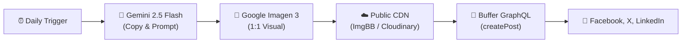

# FlexiTap POS – 100% Automated Social Media Publisher 🚀

A zero-manual-effort pipeline that automatically generates high-converting marketing copy and photorealistic visuals using **Google Gemini & Imagen 3**, and instantly publishes them across **Facebook, LinkedIn, and X (Twitter)** using the **Buffer GraphQL API**.

---

## ⚡ How It Works



1. **Copy Generation**: Generates engaging, tailored copy anchored around FlexiTap's 4 brand pillars (30+ years POS experience, 100% offline resilience, 5-min staff training, live human support), respecting tier rules (Free Waitlist vs. Founders VIP Pass) and November 13, 2026 launch CTA.
2. **AI Visual Generation**: Google Imagen 3 produces photorealistic lifestyle visuals of US restaurant/cafe/food truck setups with FlexiTap POS.
3. **Public CDN Upload**: Automatically uploads the generated visual to a public CDN so Buffer can attach it directly to your posts.
4. **Buffer Multi-Channel Publishing**: Queries connected channels and queues the post across Facebook, LinkedIn, and X simultaneously.

---

## 🛠️ Quick Setup (One-Time)

### 1. Create your `.env` file
Copy `.env.example` to `.env`:

```bash
cp .env.example .env
```

Fill in your 3 keys:
```env
# 1. From https://publish.buffer.com/settings/api
BUFFER_API_KEY=your_buffer_token_here

# 2. From https://aistudio.google.com/app/apikey
GEMINI_API_KEY=your_gemini_api_key_here

# 3. From https://api.imgbb.com (Free 1-click key for permanent image hosting)
IMGBB_API_KEY=your_imgbb_api_key_here
```

### 2. Connect Your Accounts in Buffer
In your [Buffer Dashboard](https://publish.buffer.com/channels), connect your:
- Facebook Page
- LinkedIn Page or Profile
- X (Twitter) Account

---

## 🚀 Run Manually / Test

To test the entire pipeline on demand:

```bash
node auto_publisher.mjs
# or
npm start
```

---

## ⏰ Automated Daily Schedule

To have this run completely unattended every day at 9:00 AM, our background scheduled automation triggers:
```bash
node c:/Users/JAY/Documents/antigravity/radiant-noether/auto_publisher.mjs
```
No manual clicking, uploading, or scheduling required!
